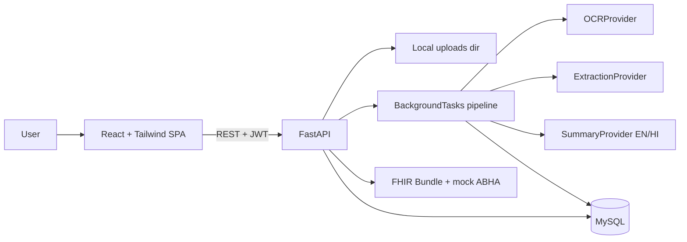

# MedCare Architecture

## Overview

MedCare is an AI-powered Personal Health Copilot. Users upload medical records; a pluggable OCR/extraction/summary pipeline structures the data into an ABDM/FHIR-aligned MySQL schema; the React UI presents summaries, a timeline, medications, and lab trends.

## Document lifecycle

`uploaded` → `processing` → `needs_review` → `confirmed` (or `failed`)

Extracted clinical facts stay unverified until the user confirms them. Confirmation publishes `timeline_events` and marks medications/observations/conditions as verified.

## Data model (FHIR mapping)

| Table | FHIR resource |
|-------|----------------|
| patients | Patient |
| documents | DocumentReference |
| medications | MedicationRequest |
| observations | Observation |
| conditions | Condition |
| encounters | Encounter |
| summaries | Composition-like narrative (custom) |
| timeline_events | denormalised UX feed |

Every clinical row includes `fhir_id` (UUID), `confidence`, and `verified`.

## AI layer

Providers are selected by `AI_PROVIDER` (default `mock`). See [ai-integration.md](./ai-integration.md).

Rule-based `reference_ranges.py` flags High/Low/Normal without an LLM, so abnormal explanations work even when AI is mocked.

## Storage

- MySQL 8 for structured data
- Local `backend/uploads/` for files (path stored on `documents.file_path`; S3-ready later)

## Security notes

- JWT bearer auth on all patient APIs
- Passwords hashed with bcrypt
- Medical disclaimer on every summary and in the global UI banner
- No diagnostic claims; wording is educational only
